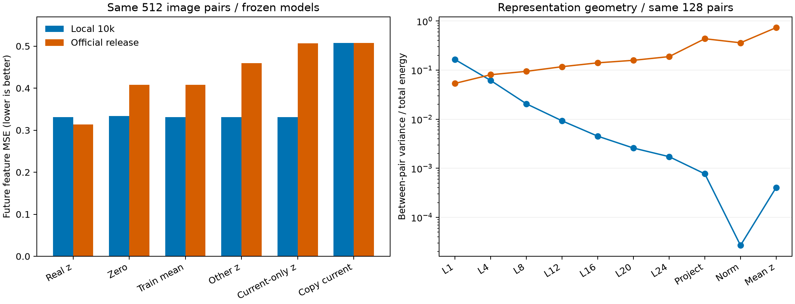

# RoboTwin 1万更新モデルのz利用と原因の切り分け

2026-11-14。対象は `robotwin-qfix-delta2-b4-20261114/checkpoints/last.ckpt`（global_step=10000）。旧RoboMINDモデルの結果とは区別する。

追加検証：[decoderへ実際に渡るz、条件付けでの減衰、IDMの状態変化probe、LeRobotとの数値照合、次のbatch64学習](robotwin-z-conditioning-proof.md)。本書の凍結モデル検査に続いて開始したbatch64・warmup10000・30000更新の別runは、ユーザー指示で停止した。修復できたという結果はまだ出ていない。

**今回のモデルは、現在特徴から未来特徴を予測する能力を学習している一方、実際にencoderが出すzの例ごとの違いをほとんど利用していない。直接の問題は、IDMからVAEへ進むにつれて入力依存の差が小さくなり、学習中のサンプリングノイズに比べて極端に弱いコードになっていること。** 画像損失・g損失の逆伝播経路は実測で接続を確認した。公式配布モデルは同じ画像予測構造・同じ画像組でzを利用できており、「この構造ではzを使えない」とは結論できない。

これは現在の重みで起きている機構の診断である。どの学習条件がこの状態を生んだか、データ追加だけで回復するかは、今回の凍結モデル実験では未確定。KLだけ、LayerNormだけ、データ量だけを根本原因と断定しない。

## テストの意味を整理する

ここで「画像予測」と呼ぶものは、RGB画像の生成ではなく、DINOの未来画像特徴の予測である。現在特徴を `x`、実際の未来特徴を `y`、decoderを `D` とする。

| 条件 | 予測・比較 | 検査するもの |
|---|---|---|
| 通常z | `D(x, μ(x,y))` と `y` | 未来を見たencoderから得るコードの利用 |
| z=0 | `D(x,0)` と `y` | 未来由来のzなしでの予測 |
| 訓練平均z | `D(x, mean_train_z)` と `y` | 例ごとのz情報を除いた予測 |
| 別エピソードz | `D(x, μ(x_other,y_other))` と `y` | 正しい未来とコードの対応の必要性 |
| current-only z | `D(x, μ(x,x))` と `y` | encoderへ現在画像を2枚入れた場合 |
| persistence | `x` と `y` | 現在特徴のコピーを未来と比べる基準 |

**persistenceは「モデルに現在画像の再構成を指示するテスト」ではない。モデルを通さず現在を未来の代わりにするため、動いた分だけ誤差が増える。** z=0でもdecoderは現在特徴を入力として未来向けに変換できる。このため、persistenceより誤差が小さいことと、zをほぼ使わないことは両立する。

「現在から典型的な未来を予測している」という仮説は今回の観測と整合する。ただし正確な未来を一意に当てられる、異なる行動を選び分けられる、ロボットの成功率が高い、という意味ではない。

## 公式配布モデルとの同条件比較

ローカルのvalidation先頭512組、415エピソード。両モデルで同一画像・時刻・DINO特徴抽出・BF16評価・別エピソードの交換先を使用。全長1.6秒の組は396件。末尾で未来をclampする組も含むが、全長の組だけでも結論は同じ。

| z条件 | ローカル1万更新：未来特徴MSE | 公式配布：未来特徴MSE |
|---|---:|---:|
| 通常z | 0.33078249 | 0.31331764 |
| 0 | 0.33330243 | 0.40780240 |
| 訓練256組の平均定数 | 0.33077614 | 0.40788300 |
| 別エピソードから交換 | 0.33077233 | 0.45955561 |
| 現在2枚から得たz | 0.33078426 | 0.50634821 |
| 現在特徴をコピー | 0.50750357 | 0.50750357 |

ローカルでz=0のMSEは通常より約0.76%高いが、共通の平均zなら差が消える。**ゼロ化の差だけを未来情報の効果と解釈してはいけない。共通のコード値がdecoderの動作を調整する効果と、例ごとの未来情報を分ける必要がある。**

平均zとの差（平均zの誤差−通常zの誤差）のエピソード単位paired bootstrap 95%区間は、ローカル `−6.35e−6 [−1.29e−5, −1.38e−7]`、公式 `+0.094565 [0.090167, 0.099039]`。ローカルは平均zがごくわずかに良い。公式では平均zへの置換で約30.18%悪化する。これらは固定重み・今回の例に条件付けた区間である。

1.6秒全長かつ腕が5cm以上動く333組でも、ローカルは通常0.364764／平均z 0.364758、公式は通常0.357668／平均z 0.450501。「静止例ばかりだから差がない」という説明は支持されない。

公式重みは[固定revisionの配布ファイル](https://huggingface.co/jialei02/lawam_lam/blob/bd993da2a0861afaac5a95ac86d2555b1313ab8c/checkpoints/pytorch_model.pt)。SHA256は `57c31dcba13c2998c4e866cdcfc427f14ae3c1b762a586778276e2100b48af88`。両モデルのDINO重み211テンソルの完全一致を確認し、モデル全体をstrict loadした。既知のTransformersコンテナ名の差だけを対応付けた。

公式gは14次元、ローカルgは有効16次元を32次元へpaddingしており、そのまま状態誤差を比較しない。画像比較ではstrict load後にgの評価を省略。ローカルでgを省略しても、全512組・全条件の画像指標が元の評価と完全一致することを検査した。公式学習データに今回の画像が含まれるかは不明なので、絶対誤差を未見データへの汎化順位とは扱わない。



右図は座標系に依存する表現の幾何量であり、情報量そのものではない。

## 損失がIDMに届くかを実測

実装は[RLinf/LaWAMの固定commit](https://github.com/RLinf/LaWAM/tree/c12168d9077edea67fe7c1b70d08b80b8e65a9c8)。`LAMEncoder → VAEQuantizer → z` が論文のinverse-dynamics posterior encoderに対応する。`g = StatePredictor` は現在状態とzから状態差分を予測する別のheadで、IDMそのものではない。

今回の学習経路は、画像SmoothL1（beta=0.1）＋状態差分L2（係数1）＋VAE KL（係数5e−5）。論文Eq.4の画像MSE・絶対未来状態という表記と、実際の公開コードのSmoothL1・状態差分は区別する。

実際の4組を使い、**学習用VAEサンプリング経路**で損失を個別に逆伝播した。optimizerは作らず、モデル重みは更新していない。

| 損失 | IDM encoderの勾配norm | VAEの勾配norm | 画像decoder | g |
|---|---:|---:|---|---|
| 画像予測 | 0.0024554 | 0.0254383 | 接続 | 非接続 |
| gの状態予測 | 0.0127090 | 0.1092668 | 非接続 | 接続 |
| 係数を掛けたKL | 0.0001888 | 0.0011845 | 非接続 | 非接続 |

各損失の和が実際の総損失と一致し、IDMの305個の学習可能テンソルへ期待する勾配が返ることをassertした。g損失は共有zを介してIDMを学習させるが、画像decoderのパラメータを直接更新するわけではない。独立した「正解zとのIDM損失」はこのStage 1にはない。

この4組ではKLの勾配normが最大ではない。これだけでKLの学習初期の影響を否定することも、gの勾配が有用な未来情報を学習させたと証明することもできない。

## どこでzの違いが弱くなるか

同じ512組のうち先頭128組で、重みを固定し、現在を保ったまま未来を現在／別例の未来に変更した。途中のquery、投影、VAE前正規化、μ・log分散を取得した。

| 場所 | ローカル：例間分散／全エネルギー | 公式：同じ量 |
|---|---:|---:|
| encoder第1層後 | 16.401% | 5.369% |
| encoder第24層後 | 0.1723% | 18.836% |
| 32次元への投影後 | 0.0770% | 43.600% |
| VAE前LayerNorm後 | 0.00268% | 36.023% |
| μ | 0.0406% | 73.512% |

ローカルの投影後ベクトルの平均normは約109,015、公式は約692。ローカルは大きな共通成分を持ち、正規化後の差が非常に小さい。現在を固定して未来を現在に変えた時、LayerNorm後の相対差RMSはローカル0.269%、公式97.75%。未来入力を読む経路が全くないのではなく、現在の重みでは最後に出る差が小さい。

ただし、表現の全体スケールや分散比率だけから情報の有無を証明することはできない。LayerNorm単独が学習崩壊を発生させたとも断定できない。以前の別データでの[診断](../research/idm/mature-checkpoint-mechanism-diagnostics.md)にも、単純なスケール調整は後段の正規化に打ち消されるという注意がある。

128組の実際のBF16評価経路から得た事後分布では、ローカルの例間μ分散和は0.0002518、条件付きノイズ分散和は0.67633。全分散 `Var(z)=Var(μ)+E[Σσ²]` の**99.9628%がサンプリングノイズ**になる。公式は信号分散6.8321／ノイズ分散18.9797で、信号対ノイズ比が大きく違う。

ローカルではμとlog分散を両方全例共通に置き換え、同じ乱数でサンプリングしてもMSEは0.31174296→0.31174189とほぼ同じ。μだけの評価で見落とした、分散経由の強い例固有情報はこの検査では見つからない。

一方、KLは約47.44 natで0ではない。厳密な「事後分布が標準正規事前分布に一致した」というposterior collapseではなく、**入力依存性と実際の利用が極端に弱い状態**と呼ぶのが適切。

初回の「FP32」実行でも公式クラスが行列積を`medium`へ設定するため、これを最高精度と取り違えない。別途encoderを`highest` FP32、VAE headをFP64にして同じ128組を再検査した。ローカルのμ分散和は0.0002318、ノイズ比率は**99.9657%**、μの例間分散／全エネルギーは0.0374%で、結論は変わらない。FP32 headとFP64 headの最大μ差は1.65e−7未満。現在固定・未来を現在へ置換したμの平均距離はローカル0.00329、公式3.7643だった。

この最高精度で、128組の経験的な対角Gaussian混合分布について「1回のサンプルzが例の識別について持ち得る情報」の上界は0.00547 nat。母集団や決定論的なμの情報量を制限する値ではない。計測の全項目は集約JSONの`precision_check`に記録した。特徴cache自体は共通の元評価から取得したもの。

## decoderは個別zを利用できるか

先頭16組で、encoder・decoderを含むモデル全体の重みを固定し、正解未来を見ながら各組の32次元zだけをAdamで80回調整した。さらに同じ16組を使う「全例共通のzだけを調整」と、調整済み個別zを別エピソードへ交換する対照を実施した。

| ローカルの条件 | 未来特徴MSE |
|---|---:|
| encoderが出す通常z | 0.324757 |
| 全例共通のzを調整 | 0.318728 |
| 各例のzを調整 | **0.299504** |
| 調整した個別zを別例へ交換 | 0.330242 |

個別zの調整でMSEは約7.78%改善し、共有定数の調整より良い。交換すると改善が消えるため、単なる共通の出力補正だけでは説明できない。現在のdecoderにも、個別の未来に適したコードを利用する能力が残っている。

**これは正解未来を直接使った診断で、実用時の予測精度や修復済みモデルではない。** zの平均normは0.788から4.463まで変化しており、通常のμの狭い分布から外れる。訓練中に使われる領域で同じ能力を引き出せるかは別の検証が必要。

追加で `D(x, μ(x,x))` を未来ではなく現在と比較した。128組でローカルの現在再構成MSEは0.173103、公式は0.0001876。公式のcurrent-only zはほぼ現在を再構成するが、ローカルではcurrent-onlyにしても通常の未来予測とほぼ同じ出力になる。これも入力した未来の違いがコード経由で出力を制御していないことと整合する。`(x,x)`を物理的なゼロ行動の教師だと仮定したわけではない。

## 文献と今回の結果から言えること

| 一次資料 | 主張 | 今回への適用と限界 |
|---|---|---|
| [LaWAM論文 §3.2 / Appendix E](https://arxiv.org/html/2606.15768v2) | 未来特徴予測と状態補助損失でzを学習し、decoderへAdaLNで条件付けする | zが将来の違いを伝えることが目的。公開コード・配布重みと論文の条件は同一と決めつけない |
| [He et al., ICLR 2019](https://arxiv.org/html/1901.05534v2) | encoderの学習が生成側に追い付かず潜在変数が無視される場合があり、encoderを多く更新する方法を実験 | 「データか構造か」の二択ではなく、更新配分・最適化も候補。今回の原因を直接証明する論文ではない |
| [Dieng et al., AISTATS 2019](https://proceedings.mlr.press/v89/dieng19a.html) | よい生成性能と有用な潜在表現は別。zを生成器の複数層に接続する構造を検証 | 予測誤差だけを成功基準にしない。ただしLaWAMは既に各層のAdaLNへzを渡すため、同じ接続を追加すれば治るとは言えない |
| [Wang et al., NeurIPS 2021](https://proceedings.neurips.cc/paper/2021/hash/2b6921f2c64dee16ba21ebf17f3c2c92-Abstract.html) | 潜在変数の識別不能性と事後分布崩壊の関係を示し、厳密推論でも起こり得ることを説明 | 最適化だけに責任を限定するのも不適切。今回の事後分布は事前分布に一致しておらず、定理をそのまま原因の証明に使わない |

## データを増やすべきか、構造を変えるべきか

**データを追加するだけで直るという根拠はない。同時に、直らないなら必ず構造の欠陥だ、という二択にもならない。** 追加の画像が似た現在→未来の対応ばかりなら、現在だけから予測する経路もさらに学習できる。重要なのは画像数だけでなく、同じような現在から異なる動作・未来へ進む例の多様性と、それをz経由で利用する学習である。これは今回の機構からの推論で、データ拡大実験の結果ではない。

現データには27,500エピソード・約608万フレームが既にある。一方、今回の更新はbatch4×10,000で延べ40,000組。保持データ量と実際に学習へ投入する量は区別する。論文Appendix E.6はbatch1024×100k更新を記載するが、これを配布checkpointの実学習履歴だとは断定できず、その規模を今回の必要条件とも扱わない。

現時点の判断は次の順序になる。

1. **既存データで学習条件を切り分ける。** 同じ初期重み・データ順・更新予算で、現行VAE、KL係数だけ0、サンプリングだけ停止、encoder更新回数の増加を分離比較する。最初から複数要因をまとめて変えない。各条件は短いGPU事前確認の後、複数seedで評価する。今回この比較学習は実施していない。
2. **実用的な初期値として公式のencoder・VAE・画像decoderを検討する。** 今回の画像組でもzの利用が確認できた組合せを保って開始する。状態headは次元・座標の契約に合わせて別途扱い、公式zだけをローカルdecoderへ無調整で差し込まない。
3. **構造を変えるなら、正しいzが必要になる教師を検証する。** 例えばz単独から状態変化を予測する補助head、または似た現在・異なる未来の対応を区別する目的を、元損失に対する対照として追加する。ただし状態変化は現在姿勢にも依存するため、z単独の補助教師がよい表現を保証するわけではない。単に現在入力を弱くして予測精度を落とし、z置換差だけ大きくする改造を成功としない。

採用基準は、未使用エピソードで通常の未来予測誤差が改善し、訓練平均・別例zへの置換で意味のある悪化があり、同じ予算で別途訓練した定数zモデルにも勝つこと。zの分散だけ、ゼロ化との差だけ、訓練誤差だけでは採用しない。[以前の別データでの比較](z-utility-matched-results.md)も、zの変動を増やすだけでは汎化利得が小さい場合を示している。

## 再現用成果物

- [数値・設定・適用範囲の集約JSON](../research/results/robotwin-z-underuse-20261114/summary.json)
- [512組の評価コード](../research/evaluate_robotwin_stage1.py)
- [実損失の逆伝播確認](../research/check_robotwin_loss_routes.py)
- [途中表現・ノイズ・個別z調整](../research/diagnose_robotwin_z.py)
- [共通z調整・交換対照](../research/probe_robotwin_oracle_controls.py)
- [最高精度での追加検査](../research/check_robotwin_head_precision.py)
- [集約・図の作成](../research/summarize_robotwin_z.py)

生データ、feature cache、途中表現、実行ログ、元の評価結果はSSD1の対象run内 `evaluations/` に保存した。元checkpointは更新していない。モデルの比較学習・データ拡大実験・ロボット実行成功率評価は今回の完了項目に含めない。

リポジトリルートからの再実行例。`RUN_DIR`はSSD1上の対象run実パス、`NEW_DIAG_DIR`は既存結果と異なる空の診断用ディレクトリに置換する。学習checkpoint保存先のルールは[AGENTS.md](../AGENTS.md)を参照。

```sh
RUN_DIR="<SSD1上の対象run>"
NEW_DIAG_DIR="$RUN_DIR/evaluations/<新しい診断ディレクトリ>"
.venv/bin/python research/diagnose_robotwin_z.py --run "$RUN_DIR" --kind local \
  --output "$NEW_DIAG_DIR/local" --cache "$NEW_DIAG_DIR/features.pt"
.venv/bin/python research/diagnose_robotwin_z.py --run "$RUN_DIR" --kind official \
  --output "$NEW_DIAG_DIR/official" --cache "$NEW_DIAG_DIR/features.pt"
.venv/bin/python research/probe_robotwin_oracle_controls.py --run "$RUN_DIR" \
  --diagnostics "$NEW_DIAG_DIR"
.venv/bin/python research/check_robotwin_head_precision.py --run "$RUN_DIR" \
  --diagnostics "$NEW_DIAG_DIR"
```

これらは対象runの保存済み設定・依存パッケージ・公式配布ファイル・先行512組評価を参照する。別環境ではそれらも移設・設定変更する必要があり、スクリプトだけで完結する評価セットではない。
