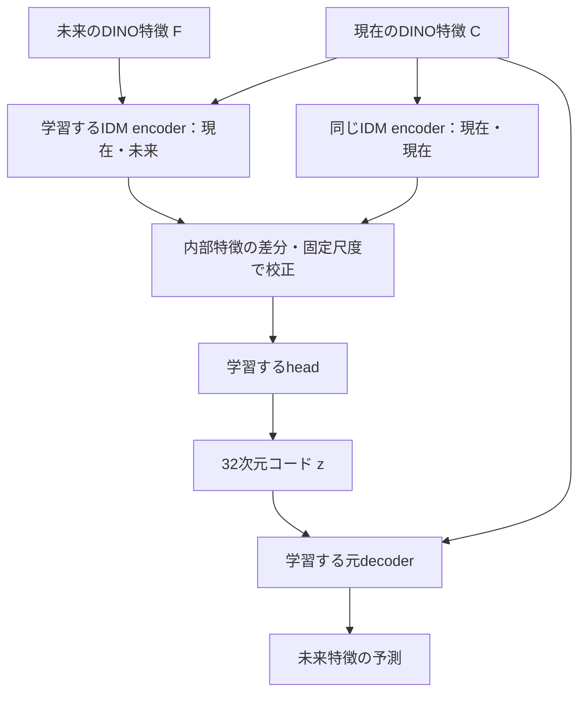

# Stage1予測改善の研究コード

現時点で精度が改善した方式は、固定した現在画像のみの予測に、参照差分IDMのコードを使う補正器を追加する直接MSE回帰である。画像そのものではなく、未来の画像特徴を予測する。元モデルへの本番統合や、実行時の行動条件付き予測の改善は未完了。

**比較基準は公式配布モデルではなく、公式由来のdirect構造をRoboMINDのみで独自に10000更新学習したモデルである。** 公式設定の混合データ・時間間隔・バッチサイズ・学習スケジュールを再現していない。この基準への改善やzの小さな追加効果を、公式LaWAM全般の結果と解釈しない。[ソース・設定の監査](idm/official-source-audit-20261113/report.md)。

## 改善した処理

現在特徴を C、正解未来特徴を Y とすると、処理は次のようになる。

1. 学習済みdecoderの行動入力をゼロにして、土台の予測 `b(C)=decoder10000(C,0)` を作る。このdecoderは固定する。
2. 固定IDM encoderの「現在・未来」のqueryから「現在・現在」のqueryを引き、訓練データで決めた尺度で校正する。別途学習したheadから32次元のposterior mean `z` を得る。
3. 現在特徴、土台の予測、zを補正器へ渡し、`Y_hat=b(C)+correction(C,b(C),z)` を直接MSEで学習する。

元の大きな予測器の知識を維持しながら、追加ネットワークにzの使い方を学ばせる構成である。補正器の出力は全特徴次元を持つ。flowの反復生成は使用しない。IDMの変更と補正器の追加を合わせた結果なので、改善全体を一方だけの効果とは呼ばない。

主要な実装は [prior_correction.py](prior_correction.py)、[wide_head_flow.py](wide_head_flow.py)、[train_cached_decoders.py](train_cached_decoders.py)、[IDM head学習](idm/train_reference_heads.py)。`wide_head_flow.py` は直接回帰とflowの共通構造を提供しており、名前だけで今回の方式をflowと解釈しない。

## 確認済みの結果

| 方法 | 既観測96例のMSE |
|---|---:|
| 元のfinal10000モデル | .103631 |
| 参照差分IDM＋補正器、train512・400更新、3 head/decoder seed平均 | .086709（16.33%減） |
| 同方式、train512・1600更新、seed42のみ | .083304（19.61%減） |

[精度の集計](results/nested512-direct-scaling-summary-20261113.json)。追加のhead学習・補正器学習を含むため、総学習費用を揃えた比較ではない。seed平均は予測ensembleではない。全て正解未来から作るzを使ったStage1再構成であり、64+96例は研究で繰り返し観測済み。カメラ運動の除去、操作意味の識別、未使用データへの汎化、会議論文としての新規性は未証明。

CPU2スレッド・float32・batch1での予測器部分の直接測定は、元モデル338.77ms、補正込み361.65ms（6.75%増）。各12回のwarm測定中央値。画像特徴抽出・IDM・読み込みは含めず、GPUは未測定。[各回の測定値](results/original-decoder-timing-20261113.json)、[ベンチコード](benchmark_original_decoder.py)。

## 内部統合版の実装と検証

[layerwise_condition.py](layerwise_condition.py) は、元の12層の画像処理を一度だけ使い、各層へ `c_l = b_old + U_l z` を渡す研究用decoderである。外付け補正器を包んだ実装ではない。32次元zはそのまま、層別の写像は一つのLinearで計算する。学習対象は393,216パラメータ。元の重みは固定し、初期予測と学習後のz=0予測は元のzero-code priorを保つ。元の通常のz付き予測を初期状態で保存する方式ではない。

これは外付け補正器の改善を等価に移植したものではなく、新しい比較候補である。下記の再構築条件でのGPU検証では、外付け版に対する精度優位は得られなかった。本番Stage1/Stage2の既定構造は変更していない。既知の層別条件付けを使うため、この変更だけを論文の新規性とは主張しない。[設計と対照条件](idm/internal-layerwise-condition-design-20261113.md)。

実モデルでの確認は [check_layerwise_condition.py](check_layerwise_condition.py) で訓練例1件・破棄する1更新を実行する。全層の非ゼロ勾配、元重みの不変性、z=0の予測一致を検査する。これは精度評価用の学習ではない。

```sh
CUDA_VISIBLE_DEVICES='' OMP_NUM_THREADS=2 .venv/bin/python research/check_layerwise_condition.py \
  --output research/results/reproduce-layerwise-smoke.json
```

同じcacheを使う400更新実験は次のコマンドで選択できる。`--train` を外すと初期状態の確認だけを行う。`--architecture shared` は以前の全層共通写像、`--arm rms_constant` はコードを固定した対照である。層別400更新はCPUの初期検証後、CUDA実行を開始した。完了結果が出るまでは精度未確認として扱う。

```sh
CUDA_VISIBLE_DEVICES='' OMP_NUM_THREADS=2 .venv/bin/python research/train_early_condition.py \
  --source . --output runs/reproduce-layerwise-real400 \
  --architecture layerwise --arm real --threads 2 --train
```

[複数指標評価](evaluate_prediction_metrics.py) は固定済みの外付け補正器をMSE、元の視覚損失Smooth L1、MAE、cosine similarity、特徴変化量で選んだ領域のMSEで比較する。変化量上位領域は物理的なロボットのマスクではない。対象は既観測64/96例で、真の未来から作ったzを使う。

固定seed42・既観測96例での追加評価は以下の通り。全体MSEだけでなく、元の視覚損失と特徴変化が大きい領域でも改善した。ただし外付け版の結果であり、内部統合版の結果ではない。[全指標・例別値・条件付きbootstrap区間](results/prediction-multimetric-20261113/results.json)。

| 指標 | 元モデル | 外付け400更新 | 外付け1600更新 |
|---|---:|---:|---:|
| Smooth L1（beta=.1、低いほど良い） | .138106 | .125132 | .123954 |
| MAE（低いほど良い） | .177759 | .163787 | .162724 |
| Cosine similarity（高いほど良い） | .944639 | .953753 | .955456 |
| 特徴変化上位10%領域のMSE | .469058 | .376009 | .358206 |

[実チェックポイントの1更新検査](results/layerwise-condition-smoke-20261113.json)は成功し、[回帰テスト](results/layerwise-validation-20261113.json)は142件通過。これらは内部統合版の実装検査であり、汎化精度・速度の改善を示すものではない。

CUDAが利用できる環境では学習コマンドに `--device cuda` を追加する（`CUDA_VISIBLE_DEVICES=''` は外す）。float32・highest設定を維持し、20更新ごとに経過時間を記録、100更新ごとにadapterとoptimizerを `latest.pt` へ保存する。旧CPU実行には途中保存がなく、CUDA実行は初期状態から開始した。CUDAの[実モデル検査](results/layerwise-cuda-smoke-20261113.json)でも初期・更新後zero-code予測の一致と各層への勾配を確認した。他用途のGPU常駐プロセスは停止していない。

## 内部統合版のGPU検証（2026-11-13、再構築条件）

別PCの研究cache・encoder2900・学習済みheadを利用できなかったため、このPCのfinal10000 checkpointと元動画から再構築した。**上の歴史的な16.33%改善の追試ではない。** 既存の選定記録と同じtrain512／validation64／既観測96の端点を照合し、final10000 encoderから参照差分queryを抽出。保持したtrain128だけで尺度を校正し、新規Gaussian head42を2000更新学習した。全方式で同じheadとコードを固定し、decoderのseed42/43/44、400更新、batch8、lr3e-4、MSE、seedごとの同一minibatchを使った。GPUはRTX 6000 Ada、float32 highest、autocastなし。encoder・headを含む3 seed追試ではない。

| 方式 | validation64 MSE ↓ | 既観測96 MSE ↓ | GPU B1予測時間 ms ↓ |
|---|---:|---:|---:|
| 元モデル・native posterior | .119655 | .102772 | 4.988 |
| 全層共通の条件写像・元重み固定 | .117685 | .102487 | 5.009 |
| **内部統合版・層別写像・元重み固定** | **.116644** | **.102141** | **5.030** |
| 層別写像・RMSを揃えた定数コード | .117640 | .101834 | 5.036 |
| 外付け直接補正器 | .106019 | .093284 | 5.706 |
| 共通条件写像＋decoder全体の追加学習 | .103420 | .094433 | 5.008 |

精度は3 decoder seedの平均リスクでありensembleではない。時間はseed42モデルのwarmup10回後、各方式40回を交互に実行した同期wall時間の中央値。外付け版は元decoderでpriorを作る処理も含む。DINO・IDM・転送・読み込みは含まない。B8時間、追加activation memory、パラメータ容量も[全結果](results/layerwise-gpu-validation-20261113/results.json)に記録した。

内部版の既観測96 MSEは元モデル比0.61%低いが、定数対照への優位はない。内部版−定数のMSE差は+.000307、条件付きpaired episode bootstrap95%区間[-.000399,+.000995]。validation64でも定数との差の区間は0を含む。共通写像よりMSEは少し良いが、外付け版より既観測96で9.49%高く、差の区間[.007289,.010577]も悪化側。内部版は外付け版よりB1で約11.85%速いものの、同程度の速度の全体追加学習にもMSEで劣る。固定重みの内部版を高精度な統合先として採用する根拠は得られなかった。

既観測96の内部版Smooth L1 .137864／MAE .177578は、元モデルの.137537／.177109よりわずかに悪い。全体MSEの小改善を全指標の改善とは呼ばない。追加学習対照は228,285,696パラメータを更新し、内部版は393,216パラメータだけなので、同容量・同学習計算の比較ではない。また追加学習対照はzero-code priorを保持しない。

内部版3 seedすべてで、初期prior一致、学習後のzero-code予測一致、元重みのhash不変性を確認。全12層の非ゼロ勾配と、全672例のzero-code/cache差が1e-4以内であることも確認した。同一GPU/backendでの初期・学習後anchor差は0、抽出B1と評価B8のcache差の最大は8.82e-6。[CPU/GPUを含む回帰テスト144件と環境](results/layerwise-gpu-environment-20261113.json)。元のビット一致テストは、異なるサイズの行列積による約2.4e-7の丸め差を許容する比較に修正した。

これらは正解未来を使うStage1再構成で、既観測評価例を再利用している。区間は学習済みheadとdecoder seedに条件付け、学習・選択の全不確実性や多重比較を扱わない。操作の意味、未知データへの汎化、実行時の行動条件付き予測の改善は示さない。既存の元cache条件でのCUDA実験とは別の結果である。

再実行は [validate_layerwise_gpu.py](validate_layerwise_gpu.py) の `prepare`、`fit`、`summarize` を使う。既存出力は上書きしない。元checkpoint・設定・動画・manifestが必要で、生成cacheと学習済み重みはGit対象外。

```sh
.venv/bin/python research/validate_layerwise_gpu.py prepare --output runs/new-layerwise-inputs
for arm in layerwise shared constant external continuation; do
  for seed in 42 43 44; do
    .venv/bin/python research/validate_layerwise_gpu.py fit \
      --source runs/new-layerwise-inputs --output runs/new-layerwise/$arm-$seed \
      --arm "$arm" --seed "$seed" --device cuda:0
  done
done
.venv/bin/python research/validate_layerwise_gpu.py summarize \
  --source runs/new-layerwise-inputs --experiments runs/new-layerwise \
  --output research/results/new-layerwise-summary --device cuda:0
```

## 差分IDMとdecoderの共同学習（新規版）

[difference_idm.py](idm/difference_idm.py) は、共有するIDM encoderを2回呼び、`z = head((Q(C,F) - Q(C,C)) / scale)` を元のdirect decoderへ直接渡す。外付け補正器やzero-code priorは使わない。DINO画像特徴だけを固定cacheとして再利用し、IDMのquery特徴は毎回計算し直す。両方のencoder呼び出しへ勾配を流し、元の24層encoder、head、12層decoderを共同学習する。以前の「内部統合版」は固定decoderの条件写像だけの学習であり、この新規版とは異なる。



ランダム初期化からの学習ではなく、final10000のencoder・decoderと、前のGPU実験でtrain128だけから学習したreference-head42の平均出力を初期値にする。元decoderの学習済みコード射影も保持して開始するが、コード分布が異なるため元モデルの通常予測との初期一致は保証しない。headの平均32次元を取り出した決定論的MSE実験であり、VAEのサンプリング・KL・状態補助損失は使用しない。`scale`は以前のtrain128校正値で固定し、評価データで再調整しない。

同じtrain512、validation64、既観測96を使用し、各400更新・batch8・3 seed（42/43/44）。encoder/head/decoderの学習率はそれぞれ1e-5/1e-4/3e-5、行列weight decay .01、bias/normは0、全体gradient clip1。float32 highest、autocastなし、GPU2枚で独立runを実行する。seedが変えるのはminibatch順序であり、初期の事前学習済み重みは共通。主比較は、初期重み・batch・損失・学習率を揃えてencoderだけを固定した`frozen_encoder`対照である。旧外付け版とは学習率・head更新・容量が異なり、同計算量の比較ではない。[固定プロトコルと実モデルsmoke](results/difference-idm-joint-protocol-20261113.json)。

**6本すべて400更新まで完了。** [全指標・例別MSE・区間・checkpoint再読込検証](results/difference-idm-joint-20261113/results.json)。以下は各方式の3 seed平均リスクで、ensembleではない。元モデルは固定した単一checkpoint。

| 方式 | validation64 MSE ↓ | 既観測96 MSE ↓ |
|---|---:|---:|
| 元モデル・native posterior | .119655 | .102772 |
| 以前の条件写像だけの内部統合版 | .116644 | .102141 |
| 以前の外付け補正器 | .106019 | .093284 |
| 差分IDMのencoder固定、head＋元decoderを学習 | .098883 | .089077 |
| **新規版：差分IDM＋元decoderを共同学習** | **.097620** | **.087628** |

新構成全体の既観測96 MSEは元モデル比14.74%減、旧外付け版比6.06%減。ただし、encoder更新による追加効果はmatchedな固定encoder対照との比較で評価し、**1.63%減**だった。3 seedすべてでMSEが低下し、seed平均のpaired episode bootstrap95%区間は差−.001449に対して[-.002422,-.000647]。validation64では平均1.28%減だが、区間[-.003262,+.000198]は0を含む。学習済み初期重みとminibatch seedに条件付けた区間であり、独立最終testや全学習過程の不確実性は扱わない。

既観測96の新規版はSmooth L1 .122497、MAE .160632、cosine similarity .953669。元モデルの.137537／.177109／.945090と固定encoder対照の.123345／.161505／.952904をいずれも改善した。一方、validation64の特徴変化下位50%領域では固定encoder対照よりMSEがわずかに悪化し、全領域・全条件での優位は主張しない。コード交換MSEは.093770、同一画像組コードでは.092295となったが、これらは操作意味の識別・カメラ不変性・実行時制御成功の証明ではない。

学習対象はencoder309,399,552、head270,624、decoder228,286,720パラメータ。3 seedとも全対象のhashが変化し、固定対照ではencoderのhashが保持された。GPUメモリの学習時最大allocatedは共同版約19.28GiB。6つの最終checkpointを元重みなしで再構築し、既観測96の先頭8例のMSEを最大8.94e-8の差で再現した。CPU/GPUを含む回帰テストは149件通過。

seed42のGPU warm推論はB1でdecoder単体5.20ms、差分IDMの2回のencoder処理を含めて47.17ms。DINOと読み込みは含めない。IDM込みの経路は正解未来を受け取る再構成であり、オンラインの行動条件付き予測の速度としては扱わない。

実装検査は両分岐への非ゼロ勾配、全24層の勾配、3部品の重み更新、同一画像組の差分が厳密に0であることを確認する。`head(0)`はゼロとは限らない。保存済みモデルの評価では通常コード、他の例とのコード交換、同一画像組に対応する`head(0)`の予測誤差も記録する。交換や同一画像組コードの劣化だけで物理的な操作意味が証明されたとは解釈しない。

[train_difference_idm.py](train_difference_idm.py) は20更新ごとの進捗と100更新ごとの`latest.pt`（モデル・optimizer）を保存する。`--resume`で同じ出力・設定から再開でき、最終`model.pt`は元checkpointなしでIDMとdecoderを再構築できる。400更新後だけを評価し、validationによるbest-step選択はしない。

```sh
.venv/bin/python research/train_difference_idm.py \
  --arm joint --seed 42 --steps 400 --microbatch 8 --device cuda:0 \
  --output runs/new-difference-idm/joint-42
# 同じ設定で --arm frozen_encoder、seed43/44も実行する。
.venv/bin/python research/summarize_difference_idm.py \
  --runs runs/new-difference-idm --output research/results/new-difference-idm
```

学習済みモデルは [load_difference_idm.py](idm/load_difference_idm.py) で読み込める。入力はDINO特徴で、画像の特徴抽出は別途必要。`model(C,F)`は正解未来を使う再構成、`model.predict(C,z)`は与えられたコードによる予測である。実行時の行動からzを作るモデルは、この学習では作っていない。

```python
import torch
from research.idm.load_difference_idm import load_trained_model
torch.set_float32_matmul_precision('highest')
model, protocol = load_trained_model(
    'runs/difference-idm-joint-20261113/joint-42/model.pt', device='cuda:0')
with torch.inference_mode():
    predicted_future, z = model(current_features, future_features)
```

### 次の検証（未実施）

2026-11-13追記：この方針はユーザー承認後、[docsの固定計画](../docs/difference-idm-ablation-plan.md)として先にpushした。差分あり／なしの新規headによる比較、400/800/1600更新の保存、未使用test170の固定とGPU smokeまで実装済み。旧400更新実験の続きとは初期headが異なる。実行状況・成果物はリンク先に記録する。

最優先は差分なしのIDMとの比較である。現在の`joint`対`frozen_encoder`はencoder更新の効果を測るが、`Q(C,F)-Q(C,C)`という差分自体の効果を分離しない。差分あり／なしでhead容量・損失・最適化・データを揃え、差分向けに学習したheadの初期値が片側だけを有利にしない条件を設ける。既観測96は独立最終testとして再利用せず、未使用episode・場面の評価集合を先に固定し、元checkpointの学習データとの重複も確認する。

その後、両方式と固定encoder対照を400→800→1600更新で比較する。train512・batch8では400更新で約6.25周相当、1600更新で約25周相当になるため、学習誤差と開発集合誤差を併記し、データ量を増やす実験も必要。現runnerの`--resume`は同一protocol専用であり、400更新の設定を1600に変更してそのまま再開はできない。延長実験には中間評価・保存を追加し、比較条件を事前に固定する。最後に、zからの相対変位・把持状態の予測や行動条件付き予測・制御成功率を調べ、未来を入力する再構成MSEの改善が操作表現の改善につながるか検証する。

## 再実行と成果物

学習済みcheckpoint、画像特徴cache、元動画、論文全文はGitへ含めない。JSON/CSVは研究時点の測定・出典・ハッシュを保存する記録であり、記載されたローカル絶対パスが別環境で存在するとは限らない。リポジトリのcloneだけでは実データ実験を再実行できない。

元データから抽出してハッシュ整合性を確認したcacheとcheckpointを配置した環境では、次のように直接補正器を学習できる。出力先は新規ディレクトリを指定する。

```sh
CUDA_VISIBLE_DEVICES='' OMP_NUM_THREADS=2 python research/train_cached_decoders.py \
  --cache runs/reference-idm42-nested512-prior10000 \
  --output runs/reproduce-prior-residual400 \
  --variants prior_residual --steps 400 --batch-size 8 \
  --dim 128 --layers 2 --threads 2 --seeds 42
```

速度比較には、さらに元final10000のweights/config/native-code cacheとFFN4補正器のcheckpointが必要。

```sh
CUDA_VISIBLE_DEVICES='' OMP_NUM_THREADS=2 python research/benchmark_original_decoder.py \
  --source . --output research/results/reproduce-original-decoder-timing.json
```

速度比較時は競合する計算を避ける。別worktreeで実行したソースの同一コピーと出所は [source manifest](results/published-worktree-sources-20261113.json) に記録した。研究履歴・未採用案・進行中の実験は [詳細記録](../docs/stage1-latent-flow.md)、100件の論文整理は [サーベイ](../surveys/flow-architecture/survey.csv) を参照。追加adapterとbounded innovationのソースは検証用であり、上表の改善を得た方式と混同しない。

小規模な実装検査はCPUで実行できる。

```sh
CUDA_VISIBLE_DEVICES='' OMP_NUM_THREADS=2 MKL_NUM_THREADS=2 python -m pytest -q \
  tests research --ignore=research/source_snapshots
```
